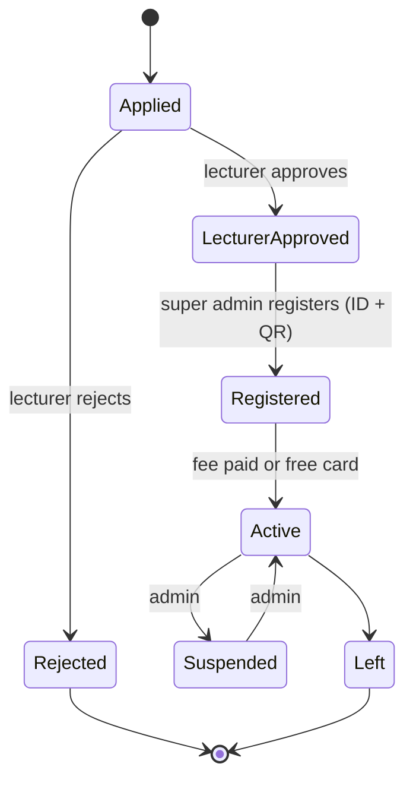
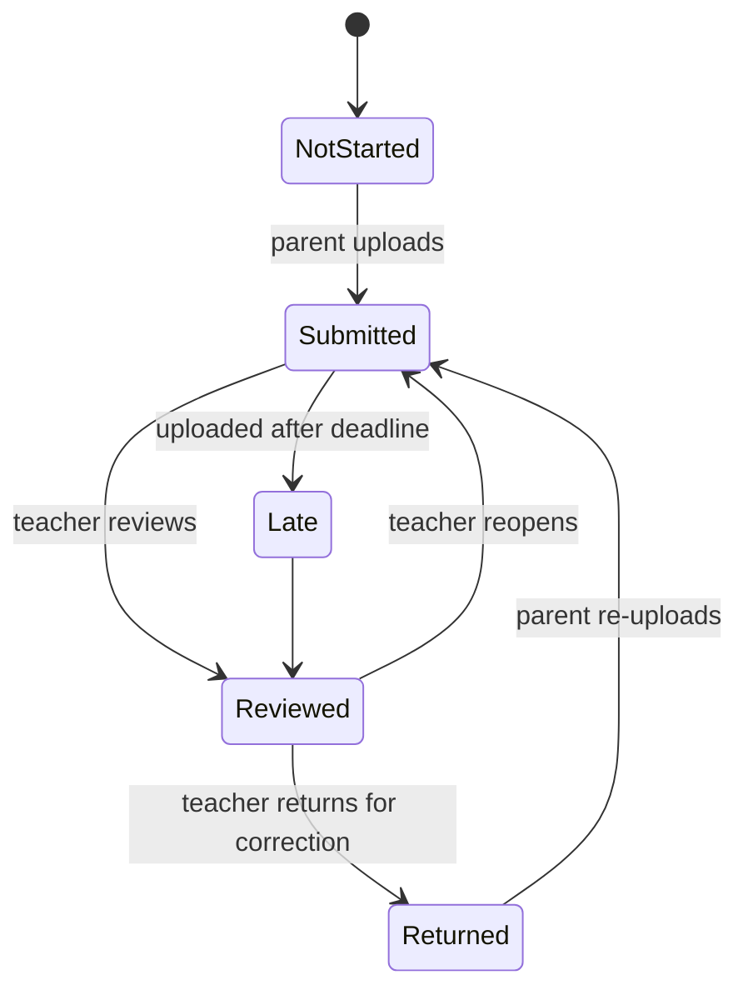
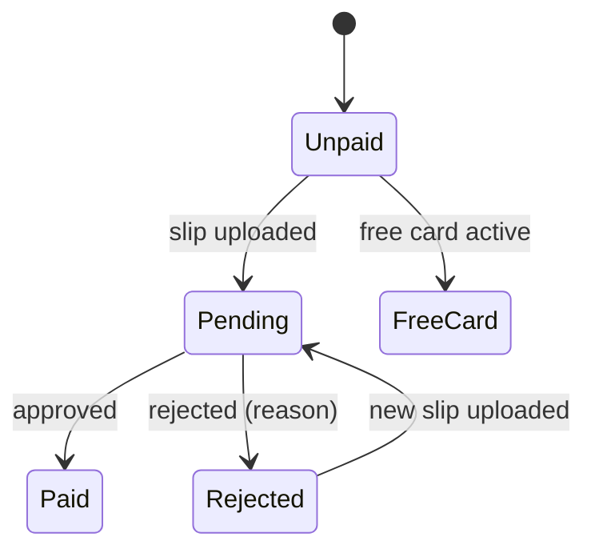

# 🎓 Institute & Nursery Learning Portal

> One portal for any educational institution, from a **nursery** to a large **institute or university**. Teachers and lecturers publish activities, lectures and quizzes. Parents and students submit work and take quizzes. The institute runs **QR attendance**, **monthly fee slips** and a **controlled printing counter**.

**Status:** 🚧 Not started  ·  **Build method:** one task at a time with Antigravity  ·  **Master checklist:** [Section 20](#20-master-implementation-checklist)

---

## 📑 Table of Contents

0. [Instructions for the AI agent (read first)](#0-instructions-for-the-ai-agent-read-first)
1. [Project overview](#1-project-overview)
2. [Design principles](#2-design-principles)
3. [Tech stack](#3-tech-stack)
4. [Roles and permissions](#4-roles-and-permissions)
5. [Registration and approval workflows](#5-registration-and-approval-workflows)
6. [Nursery module](#6-nursery-module)
7. [Institute module](#7-institute-module)
8. [Assignments](#8-assignments)
9. [Quiz engine](#9-quiz-engine)
10. [File upload and media rules](#10-file-upload-and-media-rules)
11. [Private chat](#11-private-chat)
12. [Notifications](#12-notifications)
13. [Admin panel and reports](#13-admin-panel-and-reports)
14. [Security, privacy and child safety](#14-security-privacy-and-child-safety)
15. [Non-functional requirements](#15-non-functional-requirements)
16. [Data model](#16-data-model)
17. [Project structure](#17-project-structure)
18. [Local setup](#18-local-setup)
19. [Configuration (settings and defaults)](#19-configuration-settings-and-defaults)
20. [Master implementation checklist](#20-master-implementation-checklist)
21. [Testing strategy](#21-testing-strategy)
22. [Progress log and blockers](#22-progress-log-and-blockers)
23. [Assumptions and open decisions](#23-assumptions-and-open-decisions)

---

## 0. 🤖 Instructions for the AI agent (read first)

This README is the **single source of truth**. Follow it exactly.

### Working rules

1. **Read the whole README once** before writing any code.
2. **Work strictly in order** through the [Master Implementation Checklist](#20-master-implementation-checklist). Do **one task at a time**. Never start a task while an earlier task is unticked.
3. For each task, do this loop:
   1. Read the spec sections the task points to.
   2. Implement it completely: migration, model, policy, service/action, Livewire component or controller, views, routes, seeder if needed.
   3. Write tests (see [Section 21](#21-testing-strategy)).
   4. Run `./vendor/bin/sail composer qa` (Pest + Pint + Larastan). Everything must pass.
   5. Smoke-test in the browser on a phone-sized viewport.
   6. Change `- [ ]` to `- [x]` for that task in this file.
   7. Add one line to the [Progress log](#22-progress-log-and-blockers).
   8. Commit: `feat(T-3.2): short description`.
   9. Pick the next unticked task.
4. **Do not add features that are not in this file** and do not remove any. If something is unclear or missing, write it under *Blockers* and take the safest interpretation.
5. **Nothing is hard-coded.** Limits, windows, grace days and file types come from [Settings](#19-configuration-settings-and-defaults).
6. **Security rules in [Section 14](#14-security-privacy-and-child-safety) are mandatory.** Every route and Livewire action is protected by a Policy that checks the *object*, not just the role.
7. **Free and open-source tools only.** The project must run locally without any paid service or API key.
8. **Multi-institution ready.** Every business table has `institution_id` and its model uses the `BelongsToInstitution` trait (global scope). The first release runs one institution.
9. **All user-visible text uses translation keys** (`__('...')`), never raw strings in views.
10. **Mobile first.** Design every screen for a 360 px wide phone first, then enlarge.
11. **Never store uploads under `public/`.** All files go through `FileService` ([Section 10](#10-file-upload-and-media-rules)).
12. **Keep controllers and Livewire components thin.** Business logic lives in `app/Services` and `app/Actions`.
13. If a task is too large, split it into sub-tasks (`T-3.6a`, `T-3.6b`) in the checklist instead of leaving it half done.

### Definition of Done (every task)

- [ ] Feature works as specified, including the rules listed in the spec.
- [ ] Policies and permission checks in place; a user of another role or another family gets `403`.
- [ ] Validation with clear error messages (translated).
- [ ] Feature tests written and passing; edge cases covered.
- [ ] `composer qa` passes (tests, Pint, Larastan).
- [ ] No N+1 queries on list pages (use eager loading).
- [ ] Sensitive actions write to the audit log.
- [ ] Checklist ticked, progress log updated, commit made.

---

## 1. 📘 Project overview

This is **not a full LMS**. It is a focused portal in which teachers and lecturers publish content, and parents or students use it, submit work and interact with the institution.

It has two modules on one shared core. An institution switches modules on or off depending on its type.

| Module | For | What it does |
|---|---|---|
| **Core** | Everyone | Users, roles, approvals, classes, files, assignments, quizzes, notifications, admin panel |
| **Nursery** | Nurseries, kindergartens | Teachers post activities (often YouTube videos) with extra materials and deadlines. Parents do them with the child and upload results. Teacher quizzes with pictures and matching. |
| **Institute** | Tuition institutes, colleges, universities | Pre-scheduled classes, student ID with QR code, QR attendance, monthly fee payment by slip upload, fee-gated lecture materials, printing counter, in-class MCQs, online papers, private student-lecturer chat, lecturer portfolios |

### Feature summary

- **Teachers/lecturers** are registered by admins. They publish activities, lecture materials, assignments, quizzes and online papers, and keep a public portfolio.
- **Parents** (nursery) register and are approved by an admin. They open activities, follow instructions, upload, edit, delete and re-upload work before the deadline, and do quizzes with their child.
- **Students** (institute) apply for classes from lecturer portfolios. The lecturer approves, and the super admin registers the student with a unique ID and QR code.
- **Attendance** is marked at an Attendance Station by scanning the student's QR code.
- **Fees** are paid monthly per class by uploading a payment slip. An approved slip unlocks that month's lecture materials.
- **Free-card students** are registered by admins and assigned to their classes without fees.
- **Printing:** at the institute's print shop, staff scan the QR, check the student is eligible, print, and mark the item as printed so it cannot be printed twice.
- **Quizzes** support matching (join), tick-the-correct-one, picture answers and more. In-class MCQs run live during a session.
- **Private chat** exists only between a student (or parent) and their own teacher or lecturer. Students can never chat with other students.
- **File uploads** (video, PDF, JPG, PNG, ZIP) are type-verified before upload and limited to **50 MB**.

---

## 2. 🧭 Design principles

1. **One core, switchable modules.** Users, classes, materials, assignments, quizzes and files are shared. Attendance, fees and printing are optional modules.
2. **Guardian-first for minors.** In nursery the parent logs in. In institutes and universities the student logs in. A guardian is linked to one or more children, and a student login is optional.
3. **Tenancy-ready.** Every record carries `institution_id`. One installation can serve several institutions later.
4. **Mobile-first.** Responsive web app, installable as a PWA. Large touch targets, especially for nursery.
5. **Configurable rules.** Grace days, scan windows, late policies and print limits are settings, not constants.
6. **Private by default.** Files, chats and profiles are never public. Every sensitive action is permission-checked and logged.
7. **Simple for parents.** Few screens, clear status labels, big buttons, friendly language.

---

## 3. 🧰 Tech stack

A server-rendered Laravel application. It has few moving parts, suits an agent-driven build and runs entirely on free tools.

### Core stack

| Layer | Choice | Why |
|---|---|---|
| Language | **PHP 8.3+** | Required by current Laravel |
| Framework | **Laravel (latest stable)** | Auth, queues, policies, validation, files, scheduler and notifications built in |
| Frontend | **Blade + Livewire (latest) + Alpine.js** | Server-rendered, interactive without a separate SPA |
| Styling | **Tailwind CSS** (via Vite) | Fast mobile-first UI, consistent theme tokens |
| Database | **MySQL 8** | Relational, well supported |
| Cache / queue / rate limit | **Redis** | Queues for scans, notifications and reports |
| Real-time | **Laravel Reverb** + Laravel Echo | Free, self-hosted WebSockets for chat and live quizzes |
| Auth | **Laravel Fortify** | Headless login, email verification, password reset, two-factor |
| Roles and permissions | **spatie/laravel-permission** | Roles and permissions tables, editable per institution |
| Audit log | **spatie/laravel-activitylog** | Who did what and when |
| Files | Laravel Filesystem, **private local disk** (S3-compatible later) | Files are never public |
| Chunked uploads | **pion/laravel-chunk-upload** + **Resumable.js** | Resumable 50 MB uploads on weak connections |
| Real type check | PHP `fileinfo` + custom magic-byte check | Never trust extension or browser MIME |
| Virus scan | **ClamAV** (Docker) + `sunspikes/clamav-validator` | Scans every upload |
| Images | **intervention/image** | Re-encode images and strip metadata |
| QR generate | **chillerlan/php-qrcode** | Pure PHP, SVG/PNG output |
| QR scan | **html5-qrcode** (camera) and keyboard-wedge USB scanner support | Works on phone, laptop and cheap scanners |
| PDF | **barryvdh/laravel-dompdf** | Receipts, ID cards, reports |
| Import / export | **maatwebsite/excel** | CSV and XLSX import and export |
| Charts | **Chart.js** | Dashboards and reports |
| Mail | SMTP, **Mailpit** in development | Safe local mail testing |
| SMS / WhatsApp | Provider-agnostic channel interfaces, `log` driver first | Plug in a real gateway later |
| Backups | **spatie/laravel-backup** | Scheduled DB and file backups |
| Testing | **Pest**, Livewire testing helpers | Fast, readable tests |
| Code quality | **Laravel Pint**, **Larastan** | Style and static analysis |
| Dev environment | **Docker via Laravel Sail** | MySQL, Redis, Mailpit, ClamAV, Reverb in one command |
| Production (later) | VPS, Nginx, PHP-FPM, Supervisor (queue and Reverb), cron scheduler | Cheap and simple |
| CI (optional) | GitHub Actions | Runs `composer qa` on every push |

### Composer packages

```
laravel/fortify, livewire/livewire, laravel/reverb,
spatie/laravel-permission, spatie/laravel-activitylog, spatie/laravel-backup,
pion/laravel-chunk-upload, sunspikes/clamav-validator, intervention/image,
chillerlan/php-qrcode, barryvdh/laravel-dompdf, maatwebsite/excel
dev: pestphp/pest, pestphp/pest-plugin-laravel, pestphp/pest-plugin-livewire,
     laravel/pint, larastan/larastan
```

### NPM packages

```
tailwindcss, alpinejs, laravel-echo, pusher-js, resumablejs, html5-qrcode, chart.js
```

### Composer scripts

Add to `composer.json` so one command runs every check:

```json
"scripts": {
  "qa": [
    "./vendor/bin/pint --test",
    "./vendor/bin/phpstan analyse --memory-limit=1G",
    "./vendor/bin/pest"
  ]
}
```

> If a package is abandoned or incompatible with the installed Laravel version, choose the closest maintained free alternative and note the change under [Blockers](#22-progress-log-and-blockers).

---

## 4. 👥 Roles and permissions

| Role | Created by | Main abilities |
|---|---|---|
| **Super Admin** | Seeder | Everything. Registers students and issues IDs and QR codes. Manages admins, free cards, settings, audit logs, modules. |
| **Admin / Office staff** | Super Admin | Registers teachers and lecturers. Approves parent logins. Manages classes, schedules, announcements, reports. Approves payment slips if there is no cashier. |
| **Teacher / Lecturer** | Admin (invite) | Maintains portfolio. Creates activities, materials, assignments, quizzes and papers. Approves class applications. Grades. Chats with their own students or parents. |
| **Parent / Guardian** | Self-registration, approved by Admin | Views children's activities. Submits, edits, deletes and re-uploads work. Does quizzes with the child. Sees progress. Chats with the teacher. |
| **Student** | Registered by Super Admin | Own profile and QR. Classes, materials (if fees paid), assignments, quizzes, payments, chat with own lecturers. |
| **Printing Staff** | Admin | Scans QR at the printing counter, sees eligibility, marks items printed. Nothing else. |
| **Cashier** (optional) | Admin | Verifies payment slips, issues receipts, sees collection reports. |
| **Attendance Marshal** (optional) | Admin | Operates the Attendance Station. |

Roles and permissions are **stored in tables** (spatie/laravel-permission), so each institution can adjust them. Every check is also **object-level** through Policies: a parent only sees their own children's data, a lecturer only their own classes.

### Permission groups (examples of keys)

```
users.*            create, update, suspend, invite
parents.approve    approve or reject parent accounts
teachers.manage    register and edit teachers
portfolio.publish  approve lecturer portfolios
students.register  register students, issue ID and QR
students.view      view student profiles
classes.manage     classes, schedules, sessions, holidays
enrollment.manage  assign students, free cards
attendance.scan    operate the attendance station
attendance.edit    manual attendance with reason
payments.review    approve or reject payment slips
payments.view      see payment history and reports
materials.manage   create and edit lecture materials
printing.operate   use the printing counter
printing.approve   approve reprint requests
activities.manage  create activities (teacher)
assignments.manage create and grade assignments
quizzes.manage     create quizzes and papers
chat.use           use chat
chat.audit         audit chat conversations (logged)
reports.view       view reports
settings.manage    change institution settings
audit.view         view the audit log
```

---

## 5. 🔐 Registration and approval workflows

### 5.1 Teachers and lecturers

1. An admin creates the account (name, email, phone, role).
2. The teacher receives an **invite link** by email or SMS and sets their own password.
3. The teacher completes their profile and portfolio.
4. An admin reviews and **publishes** the portfolio.

### 5.2 Parents (nursery)

1. The parent registers with name, phone, email and child details.
2. Email or phone is verified.
3. The account is **Pending**. An admin approves or rejects it (a reason is required for rejection).
4. The parent is linked to the child and the correct class or group.

### 5.3 Institute students



1. A visitor browses lecturer portfolios and class listings on the **public pages**.
2. The visitor **applies** for a class, giving student and guardian details.
3. The **lecturer** approves or rejects the application.
4. The **Super Admin** registers the student: creates the record, generates the **unique student ID**, attaches the photo, generates the **QR code**, and links the approved classes.
5. The student pays the class fee (or holds a free card) and becomes **Active** for that class.

### 5.4 Free-card students

An admin registers free-card students directly and assigns them to their classes. Each free card records:

- Type: **full** or **half**
- Reason
- Who granted it
- Start date and a **review or expiry date**

Free-card students skip fee gating but follow every other rule, including attendance and print limits.

### 5.5 Lecturer portfolio

A public page per lecturer: photo, biography, qualifications, subjects, classes with schedules and fees, sample materials and contact details. Lecturers edit it. It goes live after admin approval. Each class on it has an **Apply** button that starts the flow in 5.3.

---

## 6. 🧸 Nursery module

### 6.1 Activities

A teacher creates an activity with:

- Title, description and **step-by-step instructions**
- One or more **video links** (usually YouTube)
- **Additional learning materials** (PDF, images, links), attached while creating the activity
- Target class or group and age group
- Publish date and **deadline**
- Status: `draft`, `published`, `closed`

**Video links.** The teacher pastes a YouTube URL. The system:

1. Validates the URL and extracts the video ID (support `watch?v=`, `youtu.be/`, `embed/`, `shorts/`).
2. Fetches the title and thumbnail through YouTube's public oEmbed endpoint (no API key).
3. Shows a preview to the teacher before saving.
4. Embeds the video on the parent's page using the privacy-enhanced domain `youtube-nocookie.com`.
5. A scheduled job re-checks links; broken, private or deleted videos are flagged and the teacher is notified.

### 6.2 Deadlines and extensions

- The teacher sets a deadline when creating the activity.
- The teacher can **extend** it for everyone or for **individual children**. Each extension is logged (who, when, old and new deadline, reason).
- Parents see a **countdown** and receive a notification when a deadline is extended.
- After the deadline, uploads are **locked** unless extended. If `submissions.allow_late` is on, late submissions are allowed and flagged as late.

### 6.3 Parent submissions

Parents upload a photo, video or PDF of the completed activity, with an optional note. While the activity is open they can **edit the note, replace the file, delete the submission and re-upload**.

- Every replacement is kept as a **version**. The teacher sees the latest one.
- Deleting is a **soft delete**; records stay available for audit.
- Once the teacher marks a submission **Reviewed**, it is locked unless the teacher reopens it.
- Statuses:



### 6.4 Teacher feedback

Teachers add comments and a simple rating (stars or stickers), mark submissions reviewed, and see a class overview of who has and has not submitted.

### 6.5 Nursery-specific data

- One parent can have **several children**.
- **Emergency contacts** and **authorized pickup persons** (with optional photo).
- **Allergy and medical notes**, stored encrypted and visible only to the child's teachers and admins.
- Optional **daily or milestone reports** (later phase).

### 6.6 Parent view

A friendly feed of activities per child, due dates, status labels, and a progress view (completed activities, feedback, quiz results).

---

## 7. 🏫 Institute module

### 7.1 Classes and scheduling

A class has a subject, lecturer, monthly fee, capacity, room or online link, and a recurring schedule. From the schedule the system generates dated **sessions**. Attendance, materials and in-class MCQs attach to sessions.

- Cancellations, rescheduling and holidays are handled **per session**, and affected students are notified.
- **Academic years, terms and batches**, with a **year-end rollover** that archives old data.
- A student can enroll in **several classes**. The system warns about **schedule clashes**.
- Capacity limits and an optional waiting list.

### 7.2 Student profile

Each student has a **private profile** containing:

- Student ID, photo and QR
- Personal and guardian details
- Enrolled classes
- Attendance history
- Payment history
- Submissions and marks
- Print history
- Chat threads

Visible to the student, their guardian, their own lecturers (only for their classes) and admins.

### 7.3 Student ID and QR code

- **Student ID** format is configurable, for example `INS-26-00001` (`prefix-year-sequence`). It is unique per institution.
- The QR code contains **only an opaque, unguessable token** with a prefix, for example `LP1.<token>`. **No personal data** is encoded.
- Tokens are stored **hashed** (SHA-256) with a version. Only one token is active per student.
- **Lost card:** an admin revokes the token and issues a new one. The old QR stops working immediately.
- A printable **ID card PDF** (photo, name, ID, QR) is generated for each student.

### 7.4 Attendance

Attendance is marked at the **Attendance Station** (`/station/attendance`), the institute's main attendance page. A staff member scans each student's card with a USB scanner or a phone camera. A self-service kiosk is an optional variant.

On every scan the screen shows a large **photo**, name, today's classes and payment status, so staff can confirm the person matches the card. Show a clear green or red result with a short sound.

**Rules:**

- The student must be **enrolled** in a session happening now. If several sessions overlap, show a picker.
- The scan must fall inside the **scan window** (default 30 minutes before start to 30 minutes after start; configurable).
- Scans after the **late cutoff** (default 15 minutes after start) are marked `late`.
- **Duplicate scans** for the same session are ignored and shown as "already marked".
- Revoked or unknown tokens are rejected and logged.
- Optional setting `attendance.block_if_unpaid`: block attendance for students with unpaid fees.
- Admins can **mark attendance manually** with a required reason. Every manual change is audit-logged.
- Every scan attempt (success or failure) is written to `scan_logs`.
- Parents can be notified of absences.
- Reports per class, student and date.
- *Later:* the station queues scans offline and syncs when the connection returns.

### 7.5 Fees and payment slips

Fees are charged **monthly per class**.

1. The student selects the class and month and uploads the payment slip (image or PDF).
2. The payment is **Pending verification**.
3. A cashier or admin **approves or rejects** it (a reason is required for rejection).
4. On approval a **receipt** (PDF) is generated and the month's materials unlock.



| Status | Meaning |
|---|---|
| Unpaid | No payment yet for that class and month |
| Pending verification | Slip uploaded, waiting for review |
| Paid | Approved, materials unlocked |
| Rejected | Slip refused, student can upload again |
| Free card | Exempt from fees |

**Rules:**

- A configurable **grace period** (`fees.grace_days`) after the month starts.
- Unpaid months **lock** that month's materials but never delete them. Previously paid months stay accessible.
- **Duplicate slip detection** using the file hash and an optional reference number.
- **Discounts** such as sibling or half-fee.
- **Reminders** before the due date.
- Full **payment history** on the student profile.
- Monthly collection and **unpaid-student reports** for admins.
- *Later:* an online payment gateway.

### 7.6 Lecture materials

Lecturers upload materials per class and session: PDFs, videos (up to 50 MB) or external links, notes, and links to online papers. Each item has flags:

- **Visibility:** paid students only, or free preview
- **Printable:** yes or no
- **Downloadable:** yes or no

Materials are grouped by **month and session**. A student can open an item only if **all** of these are true:

1. They are enrolled in the class.
2. They have paid for that month, **or** hold an active free card, **or** the item is marked as a preview, **or** they are within the grace period.

### 7.7 Printing counter

The printing shop at the institute uses a simple staff screen (`/station/printing`):

1. Scan the student's QR.
2. The screen shows the photo, name, class, payment status per month, and the **printable materials** with their status (*Available*, or *Printed on a date*).
3. Staff verifies identity against the photo (and ID if needed), prints the material, and taps **Mark printed**.
4. The system records who printed it, when and how many copies. The material then shows as *Printed* and **cannot be printed again** for that student and month.

**Rules:**

- The limit applies **per material, per student, per month** (`printing.max_per_material_per_month`, default 1).
- Students with unpaid fees (and no free card) cannot be marked for printing.
- A **reprint** needs a request with a reason (for example a torn or lost copy), approved by an admin. It gives a single extra print.
- Full audit log and a **daily print report**.

### 7.8 In-class MCQs and online papers

- **In-class MCQ:** attached to a session. The lecturer starts and stops it, students answer on their own devices, there is a live timer, and it can be restricted to students who have checked in. Marking is automatic and results show immediately. Uses WebSockets (Reverb).
- **Online paper:** a timed paper with MCQs and optional file-upload answers, available during a set window. MCQs are auto-marked, other answers are marked manually.

Both use the quiz engine in [Section 9](#9-quiz-engine).

---

## 8. 📝 Assignments

Assignments work the same way in both modules. A teacher or lecturer creates one with:

- Title, instructions, attachments
- **Allowed file types** (video, PDF, JPG, PNG, ZIP; chosen per assignment)
- Maximum size (up to 50 MB)
- Deadline, late policy, resubmission limit, total marks

**Submitting:** the student or parent uploads a file. The type is verified and it is saved as a new **version**. They can replace or delete it until the deadline or until it is reviewed. All versions are kept.

**Reviewing:** the lecturer sees a submissions list filtered by status, downloads files, gives marks and feedback, and either accepts the work or **returns it for correction**.

**Extensions:** per student or for everyone, always logged.

**Statuses:** Not submitted, Submitted, Late, Returned, Graded.

The lecturer can ask for different file types in different assignments, for example a video in one and screenshots in another.

---

## 9. ❓ Quiz engine

| Question type | Notes |
|---|---|
| Single choice | Answers can be text or **pictures** |
| Multiple choice | More than one correct option |
| True / False | |
| **Matching (join)** | Text to text, picture to text, or picture to picture |
| **Picture answers** | Tick the correct picture |
| Fill in the blank | Auto-marked against accepted answers |
| Ordering | Put items in the correct sequence |
| Short answer | Marked manually |

**Matching on touch screens:** support both drawing a line and tapping one item then its pair.

**Quiz settings:** time limit, number of attempts, shuffle questions and options, availability window, marks per question, optional negative marking, and when answers are shown (after submitting, after closing, or never).

**Marking and results:** objective questions are auto-marked. A **manual marking queue** handles the rest. Reports show results per student, per question difficulty and the class average.

**Question bank:** questions can be tagged and reused across quizzes.

**Nursery mode:** large pictures and buttons, optional **audio read-aloud**, no time pressure, parent-assisted answering, friendly feedback.

A quiz can be attached to an **activity, a class, a session**, or stand alone. Modes: `standard`, `nursery`, `live` (in-class), `paper` (online paper).

---

## 10. 📎 File upload and media rules

### Allowed types

| Type | Allowed formats | Used for |
|---|---|---|
| Video | MP4, MOV, WebM | Assignments and submissions (50 MB max) |
| Document | PDF | Materials, assignments, slips |
| Image | JPG, PNG | Submissions, quiz answers, payment slips, photos |
| Archive | ZIP | Assignments where the lecturer allows it |

### Rules for every upload

1. **50 MB maximum per file**, enforced in the browser and on the server. Raise PHP (`upload_max_filesize`, `post_max_size`) and Nginx (`client_max_body_size`) limits to match.
2. The lecturer chooses the allowed types for each assignment.
3. The **real file type is verified from the file contents** (signature bytes), not from the extension or the browser-reported type.
4. Files are **virus-scanned** before being accepted. Flagged files are quarantined.
5. **ZIP files** have limits on number of entries and total uncompressed size, and archives containing executables or scripts are rejected.
6. **Images are re-encoded** and hidden metadata (EXIF) is removed.
7. Files are **renamed with random names** and stored in **private storage** outside the public web root. They are served only through permission-checked or expiring links, and videos are streamed with range requests.
8. Uploads are **chunked and resumable**, with a progress bar and automatic retry, because 50 MB on a weak mobile connection often fails.
9. **Storage quotas**, retention rules, cleanup of orphaned files, and regular backups.
10. Rejected uploads show a **clear reason** to the user.

### Upload pipeline (`FileService`)

```
chunk upload -> assemble -> size check -> magic-byte type check -> extension whitelist
  -> (image) re-encode + strip metadata -> (zip) inspect entries -> virus scan (queued)
  -> store on private disk with UUID name -> create file_assets row -> status: pending | clean | infected
```

A file is usable only when `scan_status = clean`. YouTube and other external video links are **not uploads**; they are validated and embedded as in [Section 6.1](#61-activities).

---

## 11. 💬 Private chat

- **One-to-one** chat between a student and their own lecturer or teacher, scoped to the class. **Students cannot chat with other students.**
- In nursery, chat is between the **parent and the teacher**.
- Text plus limited attachments that follow the file rules in Section 10.
- **Child-safety controls:** admin audit access to conversations under a documented policy (every audit view is logged), a report button, message retention rules, and optional teacher availability hours.
- Notification for each new message. Updates arrive in real time through WebSockets (Reverb), with polling as a fallback.

---

## 12. 🔔 Notifications

**Channels:** in-app, email, SMS, WhatsApp (optional) and PWA push. SMS and WhatsApp are provider-agnostic interfaces with a `log` driver first.

**Events:**

- Account approved or rejected
- New activity or material
- Deadline approaching or extended
- Submission reviewed or returned
- Payment slip approved or rejected
- Fee due reminder
- Class cancelled or rescheduled
- Absence alert
- New chat message
- Announcements

Users choose which channels they receive. Admins can send **announcements** to everyone, a class or a group.

---

## 13. 🛠️ Admin panel and reports

**Admin panel sections**

- **Users:** register teachers and lecturers, approve or reject parents, register students and free-card students, assign classes, suspend or deactivate accounts.
- **QR and ID cards:** generate, reissue and print student ID cards.
- **Academics:** classes, schedules, sessions, holidays, academic years, rollover.
- **Finance:** verification queue for payment slips, fee settings, receipts, discounts, reminders.
- **Approvals queue:** parents, portfolios, reprint requests, free cards.
- **Settings:** scan windows, grace days, print limits, file types and sizes, institution branding, enabled modules.
- **Communication:** announcements and notification templates.
- **Tools:** bulk CSV import and export, audit log viewer, backup status.
- Admin accounts use **two-factor authentication**.

**Reports**

- Attendance by class, student and date
- Monthly fee collection and unpaid students
- Print activity (daily print report)
- Assignment completion
- Quiz results and question difficulty
- Free-card list

All reports can be filtered and exported to CSV, XLSX and PDF.

---

## 14. 🔒 Security, privacy and child safety

- **Role-based access with object-level checks** (Policies) on every request, so changing an ID in a URL never exposes another person's data. Write a test for this on every resource.
- HTTPS everywhere, hashed passwords (bcrypt/argon2), **rate limiting** and login lockouts, session management, and protection against CSRF, XSS and SQL injection (use Eloquent bindings, escape output, never `{!! !!}` on user content).
- **Two-factor authentication** for admin and super admin accounts.
- **Audit log** for sensitive actions: approvals, manual attendance, extensions, reprints, payment decisions, file deletions, role changes, chat audits.
- **Parental consent** at registration, including photo consent. Collect only the data that is needed. Do not store government ID numbers.
- **Medical notes and children's data** have restricted access (encrypted at rest with Laravel's `encrypted` cast, visible only to the child's teachers and admins).
- Retention and deletion rules follow the data-protection law that applies to the institution. Provide a data export and a delete/anonymize action for a student or guardian.
- Students under 18: no student-to-student contact, and chat is monitored under a published policy.
- **Soft delete** user-generated content so evidence is not lost.
- Signed, short-lived URLs for private files. Never expose storage paths.
- Security headers (CSP, `X-Frame-Options`, `X-Content-Type-Options`, `Referrer-Policy`).
- Validate every upload as in Section 10. Reject, log and notify on failure.
- QR tokens are opaque, stored hashed, revocable, and rate-limited at the scan endpoint.

---

## 15. ⚙️ Non-functional requirements

- **Usability:** mobile-first, simple screens for parents, large touch targets for nursery.
- **Performance:** attendance and print scans respond in under one second. Paginate every list. No N+1 queries.
- **Reliability:** daily backups, a tested restore, error logging and monitoring.
- **Scalability:** a queue for background jobs (virus scans, notifications, report generation). Storage can move to S3-compatible object storage by changing config.
- **Localization:** multi-language interface (translation files), correct time zone and date handling (store UTC, show institution time zone).
- **Accessibility:** readable contrast and font sizes, alt text for images, keyboard-friendly forms.
- **PWA:** installable, with an offline fallback page.

---

## 16. 🗄️ Data model

Every business table has `institution_id` (indexed) and timestamps. Use soft deletes where noted (SD). Enums are PHP backed enums in `app/Enums`.

### Users and people

- `institutions` — name, slug, type (`nursery|institute|university|mixed`), logo_file_id, timezone, locale
- `settings` — institution_id, key, value, type
- `users` — name, email, phone, password, status (`pending|active|rejected|suspended`), locale, email_verified_at, phone_verified_at, two-factor columns, last_login_at
- roles and permissions — spatie tables
- `guardians` — user_id, address, relationship
- `students` — student_code (unique per institution), user_id (nullable), first_name, last_name, dob, photo_file_id, status (`applied|lecturer_approved|registered|active|rejected|suspended|left`), kind (`nursery|institute`), registered_by, registered_at (SD)
- `guardian_student` — guardian_id, student_id, relationship, is_primary
- `emergency_contacts` — student_id, name, phone, relationship
- `authorized_pickups` — student_id, name, phone, relationship, photo_file_id
- `medical_notes` — student_id, note (encrypted), updated_by
- `teacher_profiles` — user_id, bio, qualifications, subjects, photo_file_id, portfolio_status (`draft|pending|published`), published_at

### Academics

- `academic_years` — name, starts_on, ends_on, is_current; `terms` — academic_year_id, name, dates
- `school_classes` — academic_year_id, teacher_id, title, subject, kind (`nursery_group|institute_class`), fee_amount, capacity, room, online_url, description, status
- `class_schedules` — class_id, weekday, starts_at, ends_at, valid_from, valid_to
- `class_sessions` — class_id, date, starts_at, ends_at, status (`scheduled|cancelled|completed`), cancel_reason, rescheduled_from_id
- `holidays` — date, name
- `enrollments` — student_id, class_id, status (`active|waitlisted|dropped|completed`), source (`application|admin|free_card`), enrolled_at
- `applications` — class_id, applicant and guardian details, student_id (nullable), status (`applied|lecturer_approved|rejected|registered`), decided_by, reason
- `free_cards` — student_id, class_id (nullable = all), type (`full|half`), reason, granted_by, starts_on, review_on, expires_on, status

### QR and attendance

- `qr_tokens` — student_id, token_hash, version, status (`active|revoked`), issued_by, issued_at, revoked_at, revoke_reason
- `attendance_records` — session_id, student_id, status (`present|late|absent|excused`), scanned_at, scanned_by, method (`qr|manual`), manual_reason; unique(session_id, student_id)
- `scan_logs` — student_id (nullable), session_id (nullable), result (`ok|duplicate|outside_window|not_enrolled|revoked|unknown|blocked_unpaid`), station, scanned_by, created_at

### Money

- `discounts` — student_id, class_id (nullable), type (`percent|fixed`), value, reason, granted_by, starts_on, ends_on
- `payments` — student_id, class_id, month (first day), amount, status (`pending|approved|rejected`), slip_file_id, slip_hash, reference_no, submitted_at, reviewed_by, reviewed_at, reject_reason
- `receipts` — payment_id, number, issued_at, pdf_file_id

### Content

- `activities` — class_id, created_by, title, description, instructions, age_group, status, publish_at, deadline_at, closed_at (SD)
- `activity_videos` — activity_id, url, video_id, title, thumbnail_url, status (`ok|broken`), checked_at
- `learning_materials` — materialable (activity | session | class), title, kind (`file|link|note`), file_id, url, visibility (`paid_only|preview`), is_printable, is_downloadable, month, sort
- `deadline_extensions` — extendable (activity | assignment), student_id (nullable = everyone), old_deadline, new_deadline, extended_by, reason
- `assignments` — class_id, session_id (nullable), created_by, title, instructions, allowed_types (json), max_size_mb, deadline_at, late_policy, max_versions, total_marks, status
- `submissions` — submittable (activity | assignment), student_id, submitted_by, status, note, marks, feedback, rating, reviewed_by, reviewed_at, locked_at, is_late (SD)
- `submission_versions` — submission_id, version_no, file_id, note (SD)

### Assessment

- `quizzes` — quizzable (class | session | activity | null), title, mode (`standard|nursery|live|paper`), time_limit, max_attempts, shuffle_questions, shuffle_options, opens_at, closes_at, show_answers, negative_marking, status
- `questions` — quiz_id (nullable for bank), type, body, image_file_id, audio_file_id, marks, explanation, tags
- `question_options` — question_id, text, image_file_id, is_correct, sort
- `match_pairs` — question_id, left_text, left_image_file_id, right_text, right_image_file_id
- `quiz_attempts` — quiz_id, student_id, taken_by_user_id, started_at, submitted_at, score, status
- `attempt_answers` — attempt_id, question_id, answer (json), is_correct, marks_awarded, needs_manual
- `live_quiz_runs` — quiz_id, session_id, state (`lobby|running|closed`), started_at, ended_at, current_question

### Printing

- `print_records` — material_id, student_id, class_id, month, printed_by, printed_at, copies; unique(material_id, student_id, month) unless a reprint is approved
- `reprint_requests` — print_record_id, requested_by, reason, status (`pending|approved|rejected`), approved_by, decided_at, used_at

### Communication and system

- `chat_threads` — class_id, student_id, teacher_id, guardian_user_id (nullable), status
- `chat_messages` — thread_id, sender_id, body, file_id, read_at, flagged_at (SD)
- `chat_reports` — message_id, reported_by, reason, status
- `notifications` (Laravel standard), `notification_preferences`
- `announcements` — scope, class_id, title, body, created_by, publish_at
- `file_assets` — uuid, disk, path, original_name, extension, mime_verified, size, hash_sha256, kind, scan_status (`pending|clean|infected|error`), uploaded_by, purpose (SD)
- `activity_log` — spatie standard audit table

---

## 17. 🗂️ Project structure

```
app/
  Actions/               single-purpose business actions (RegisterStudent, ApprovePayment, ...)
  Enums/                 StudentStatus, PaymentStatus, SubmissionStatus, QuestionType, ...
  Http/Controllers/      downloads, chunk upload endpoint, station endpoints
  Jobs/                  ScanFile, GenerateSessions, CheckVideoLinks, SendFeeReminders
  Livewire/
    Admin/  Teacher/  Parent/  Student/  Station/  Public/  Shared/
  Models/                with BelongsToInstitution trait
  Notifications/         one class per event in Section 12
  Policies/              one per model
  Services/              FileService, QrService, AttendanceService, FeeService,
                         MaterialAccessService, PrintService, QuizGrader,
                         ScheduleGenerator, YoutubeService, SettingsService
  Support/               helpers, traits (BelongsToInstitution)
config/portal.php        defaults for Section 19
database/{migrations,seeders,factories}
lang/{en,...}            translation files
resources/{views,css,js}
routes/{web.php,admin.php,teacher.php,parent.php,student.php,station.php,channels.php}
tests/{Feature,Unit}
docs/{PROGRESS.md,DECISIONS.md}
docker-compose.yml       (generated by Sail, plus clamav and reverb services)
```

---

## 18. 🐳 Local setup

```bash
# 1. Create the project (use the latest stable Laravel)
composer create-project laravel/laravel learning-portal
cd learning-portal

# 2. Add Sail and start containers (MySQL, Redis, Mailpit, ClamAV)
php artisan sail:install --with=mysql,redis,mailpit
./vendor/bin/sail up -d

# 3. Install dependencies
./vendor/bin/sail composer install
./vendor/bin/sail npm install && ./vendor/bin/sail npm run dev

# 4. Configure and migrate
cp .env.example .env
./vendor/bin/sail artisan key:generate
./vendor/bin/sail artisan migrate --seed

# 5. Run workers (separate terminals)
./vendor/bin/sail artisan queue:work
./vendor/bin/sail artisan reverb:start
./vendor/bin/sail artisan schedule:work
```

Seeded accounts (development only; passwords come from `.env`): one Super Admin, one Admin, one Teacher, one Parent, one Student, one Printing Staff, one Cashier, plus demo classes.

---

## 19. 🎛️ Configuration (settings and defaults)

Defaults live in `config/portal.php`. Each institution can override them in the `settings` table through the admin panel.

| Key | Default | Meaning |
|---|---|---|
| `modules.nursery` | `true` | Enable the nursery module |
| `modules.institute` | `true` | Enable attendance, fees, printing and related features |
| `student.id_format` | `INS-{YY}-{SEQ5}` | Student ID pattern |
| `attendance.window_before_min` | `30` | Scan allowed this long before start |
| `attendance.window_after_min` | `30` | Scan allowed this long after start |
| `attendance.late_after_min` | `15` | Marked late after this |
| `attendance.block_if_unpaid` | `false` | Block attendance for unpaid students |
| `fees.grace_days` | `7` | Access kept this long into a new month |
| `fees.reminder_days_before` | `3` | Fee reminder lead time |
| `printing.max_per_material_per_month` | `1` | Print limit per material, student and month |
| `uploads.max_size_mb` | `50` | Maximum size for every file |
| `uploads.chunk_size_mb` | `2` | Chunk size for resumable uploads |
| `uploads.allowed_types` | `mp4,mov,webm,pdf,jpg,png,zip` | Global whitelist |
| `uploads.zip_max_entries` | `200` | ZIP inspection limit |
| `uploads.zip_max_uncompressed_mb` | `200` | ZIP inspection limit |
| `submissions.allow_late` | `true` | Allow late uploads (flagged) |
| `submissions.lock_after_review` | `true` | Lock submission once reviewed |
| `quiz.live.require_checkin` | `true` | Live quiz limited to checked-in students |
| `chat.enabled` | `true` | Enable chat |
| `chat.hours` | `null` | Optional teacher availability hours |
| `chat.retention_days` | `365` | Message retention |
| `notifications.channels` | `mail,database` | Enabled channels |
| `locale.default` | `en` | Default language |
| `timezone` | institution value | Display time zone |

---

## 20. ✅ Master implementation checklist

Work **top to bottom**. Tick a box only when the task meets the [Definition of Done](#definition-of-done-every-task). The `§` marks point to the spec.

### Phase 0: Foundations

- [x] **T-0.1** Create the Laravel project with Sail (MySQL, Redis, Mailpit, ClamAV), git repo, `.env.example`, `.gitignore`, `docs/PROGRESS.md`, `docs/DECISIONS.md`. (§3, §18)
- [x] **T-0.2** Install and configure all packages, Pint, Larastan and Pest, and add the `composer qa` script. *Done when* `composer qa` passes on the empty project. (§3)
- [x] **T-0.3** Tailwind theme tokens (colors, fonts, spacing), base Blade layouts (public, app, station), responsive navigation, Livewire and Alpine working. (§2)
- [x] **T-0.4** UI component library: buttons, inputs, selects, cards, modals, tables, tabs, status pills, toasts, empty states, file-drop, countdown, pagination. All phone-friendly.
- [x] **T-0.5** Institution foundation: `institutions`, `BelongsToInstitution` trait with global scope, current-institution resolver, `SettingsService` reading `config/portal.php` defaults, module toggles with middleware. (§19)
- [x] **T-0.6** Seed roles and permissions, base Policy helpers, Super Admin seeder, permission middleware. (§4)
- [x] **T-0.7** Audit logging with `spatie/laravel-activitylog`, an `audit()` helper, audit log viewer stub. (§14)
- [x] **T-0.8** `FileService`: `file_assets`, magic-byte type check, size and type whitelist, private disk with UUID names, signed download route with policy check. *Done when* tests prove a renamed fake file is rejected, a file over 50 MB is rejected, and a direct URL to storage is not reachable. (§10)
- [x] **T-0.9** Image re-encode and metadata strip, ZIP inspection (entry and size limits, no executables), queued ClamAV scan, `scan_status`, quarantine. (§10)
- [x] **T-0.10** Chunked, resumable upload endpoint and a reusable Resumable.js component with progress bar, retry and clear error messages. (§10)
- [x] **T-0.11** Notification foundation: `NotificationService`, event-to-channel mapping, user preferences, mail and database channels, SMS and WhatsApp interfaces with `log` driver. (§12)
- [x] **T-0.12** Localization (translation files, locale switcher) and time zone helpers (store UTC, show institution time zone). (§15)
- [x] **T-0.13** PWA manifest, icons, service worker with offline fallback page. (§15)
- [x] **T-0.14** *(Optional)* GitHub Actions workflow that runs `composer qa`.

### Phase 1: Authentication, registration and approvals

- [x] **T-1.1** Fortify: login, logout, password reset, email verification, throttling, role-based redirect to each dashboard. (§5)
- [x] **T-1.2** Enforced two-factor authentication for Admin and Super Admin, with recovery codes. (§14)
- [x] **T-1.3** Admin registers a teacher or lecturer. Invite link by email or SMS, teacher sets own password. (§5.1)
- [x] **T-1.4** Parent self-registration with parent and child details, consent checkboxes (including photo consent), email or phone verification, status `pending`, "awaiting approval" page. (§5.2)
- [x] **T-1.5** Admin approvals queue for parents: approve or reject with a reason, notifications, audit. (§5.2)
- [x] **T-1.6** Nursery `students` and `guardians`: CRUD, `guardian_student` links, several children per parent, admin links parent to child and class. (§6.5)
- [x] **T-1.7** User profile, password change, notification preferences, language. 
- [x] **T-1.8** Dashboard shells for Admin, Teacher, Parent, Student, Printing Staff, Cashier and Attendance Marshal.
- [x] **T-1.9** Admin user management: list, search, filter, suspend, reactivate, deactivate.

### Phase 2: Public site and lecturer portfolios

- [x] **T-2.1** Public landing page using institution branding.
- [x] **T-2.2** Lecturer portfolio editor (photo, biography, qualifications, subjects, sample materials) with `draft → pending → published`. (§5.5)
- [x] **T-2.3** Admin portfolio review and publish.
- [x] **T-2.4** Public lecturer directory, portfolio page, and class listing with schedule, fee and an **Apply** button (wired in T-7.1).

### Phase 3: Academics core

- [x] **T-3.1** Academic years, terms and batches or groups. (§7.1)
- [x] **T-3.2** Classes CRUD for `nursery_group` and `institute_class` (fee, capacity, room or online link, lecturer). 
- [x] **T-3.3** Weekly schedules and `ScheduleGenerator` that creates dated sessions; safe regeneration that never deletes sessions with data.
- [x] **T-3.4** Holidays, per-session cancellation and rescheduling with reason and notifications.
- [x] **T-3.5** Enrollment: admin assigns students, capacity, waiting list, drop, and **schedule clash warning** for students in several classes.
- [x] **T-3.6** Teacher dashboard: my classes, upcoming sessions, my students.
- [x] **T-3.7** Year-end rollover that archives old data and copies classes.

### Phase 4: Nursery module (activities)

- [x] **T-4.1** Activities CRUD with `draft | published | closed`, target class or group, age group, publish date, instructions. (§6.1)
- [x] **T-4.2** `YoutubeService` and component: URL validation, ID extraction for all URL forms, oEmbed title and thumbnail preview, `youtube-nocookie.com` embed, several videos per activity. (§6.1)
- [x] **T-4.3** Additional learning materials on an activity (files and links), added while creating it. (§6.1)
- [x] **T-4.4** Parent feed and activity page: instructions, videos, materials, countdown, per-child status. (§6.6)
- [x] **T-4.5** Deadlines and **extensions** for everyone or per child, with log, notification and live countdown update. (§6.2)
- [x] **T-4.6** Parent submissions: upload with note, **edit, replace, soft delete, re-upload**, versions, lock after deadline or review, late flag. *Done when* tests cover every status transition. (§6.3)
- [x] **T-4.7** Teacher review screen: who submitted and who has not, latest version, comments, rating or stickers, mark reviewed, return, reopen. (§6.4)
- [x] **T-4.8** Emergency contacts, authorized pickup persons, encrypted medical notes with restricted policy. (§6.5)
- [x] **T-4.9** Parent progress view per child (activities, feedback, quiz results). (§6.6)
- [x] **T-4.10** Scheduled jobs: video link health check with teacher notification, deadline reminders. (§6.1)

### Phase 5: Assignments (shared)

- [ ] **T-5.1** Assignments CRUD: allowed file types per assignment, max size up to 50 MB, deadline, late policy, resubmission limit, total marks, attachments. (§8)
- [ ] **T-5.2** Student or parent submission with versions, replace, delete, type verification and per-assignment allowed types. (§8, §10)
- [ ] **T-5.3** Extensions for one student or everyone, always logged. (§8)
- [ ] **T-5.4** Lecturer review: list and filter by status, download, marks, feedback, **return for correction**, accept. (§8)
- [ ] **T-5.5** Student view of status, marks and feedback per assignment.

### Phase 6: Quiz engine

- [ ] **T-6.1** Question model and question bank with tags; all question types CRUD. (§9)
- [ ] **T-6.2** Image and audio support for questions and answer options through `FileService`. (§9)
- [ ] **T-6.3** Quiz builder with all settings, attachable to an activity, class, session or standalone. (§9)
- [ ] **T-6.4** Attempt UI for single, multiple, true/false, picture answers, fill in the blank, ordering and short answer; timer, shuffling, attempt limit, availability window. (§9)
- [ ] **T-6.5** **Matching (join)** UI for text and picture pairs, with both draw-a-line and tap-to-pair on touch screens. (§9)
- [ ] **T-6.6** `QuizGrader`: auto marking, optional negative marking, manual marking queue. (§9)
- [ ] **T-6.7** Nursery mode: large pictures and buttons, audio read-aloud, no timer, parent-assisted, friendly feedback. (§9)
- [ ] **T-6.8** Results and analytics per student, per question difficulty, class average, and the show-answers policy. (§9)

### Phase 7: Student registration, ID and QR

- [ ] **T-7.1** Public application form that creates an `application` and notifies the lecturer. (§5.3)
- [ ] **T-7.2** Lecturer approves or rejects an application with a reason. (§5.3)
- [ ] **T-7.3** Super Admin registers the student: record, **unique student ID** generator, photo, linked classes, status `registered`. (§5.3, §7.3)
- [ ] **T-7.4** `QrService`: opaque token, hashed storage, versioning, SVG and PNG output. (§7.3)
- [ ] **T-7.5** Printable **ID card PDF** with photo, name, ID and QR. (§7.3)
- [ ] **T-7.6** **Lost card**: revoke the old token and issue a new one, audit-logged; the old QR stops working at once. (§7.3)
- [ ] **T-7.7** Student **private profile** page with all sections and strict permissions. (§7.2)
- [ ] **T-7.8** Optional student login and student dashboard.
- [ ] **T-7.9** **Free-card** management: type full or half, reason, granted by, review and expiry dates, class assignment, review reminders. (§5.4)
- [ ] **T-7.10** Student status machine transitions with audit (`active`, `suspended`, `left`). (§5.3)

### Phase 8: Attendance

- [ ] **T-8.1** `AttendanceService`: session detection, scan window, late rule, duplicate, not enrolled, revoked token, optional unpaid block. *Done when* unit tests cover every `scan_logs.result`. (§7.4)
- [ ] **T-8.2** **Attendance Station** (`/station/attendance`): camera and USB-wedge scanning, large photo, green or red result with sound, session picker. (§7.4)
- [ ] **T-8.3** `scan_logs` for every attempt, with rate limiting on the scan endpoint. (§14)
- [ ] **T-8.4** Manual attendance with required reason and audit. (§7.4)
- [ ] **T-8.5** Attendance reports per class, student and date; parent absence notifications. (§7.4, §13)
- [ ] **T-8.6** *(Later)* Offline scan queue that syncs when the connection returns.

### Phase 9: Fees and payments

- [ ] **T-9.1** Fee calculation: class fee, discounts, half-fee, month handling. (§7.5)
- [ ] **T-9.2** Student uploads a payment slip for a class and month; status `pending`; **duplicate detection** by file hash and reference number. (§7.5)
- [ ] **T-9.3** Cashier or admin verification queue: approve or reject with reason, notifications. (§7.5)
- [ ] **T-9.4** Receipt PDF with receipt number generated on approval. (§7.5)
- [ ] **T-9.5** Payment history on the profile, unpaid list, fee-reminder job. (§7.5)
- [ ] **T-9.6** Discounts management (sibling, half-fee). (§7.5)
- [ ] **T-9.7** Monthly collection report. (§13)

### Phase 10: Lecture materials and access gating

- [ ] **T-10.1** Lecture materials CRUD per class, session and month with flags: visibility, printable, downloadable. (§7.6)
- [ ] **T-10.2** `MaterialAccessService`: enrolled **and** (paid, or free card, or preview, or within grace). *Done when* tests cover each combination. (§7.6)
- [ ] **T-10.3** Student materials library grouped by month and session, with a locked state and a clear "upload your slip" prompt. (§7.6)
- [ ] **T-10.4** Secure download and video streaming with signed URLs and range requests. (§10)
- [ ] **T-10.5** Links to online papers inside materials. (§7.6)

### Phase 11: Printing counter

- [ ] **T-11.1** `PrintService`: eligibility (paid or free card) and the per material, per student, per month limit. (§7.7)
- [ ] **T-11.2** **Printing counter** (`/station/printing`): scan, photo, status per material, **Mark printed**. (§7.7)
- [ ] **T-11.3** Reprint request with reason, admin approval, single-use allowance. (§7.7)
- [ ] **T-11.4** Print audit trail and **daily print report**. (§7.7, §13)

### Phase 12: In-class MCQs and online papers

- [ ] **T-12.1** Live quiz runs: lecturer starts and stops, Reverb events, live timer. (§7.8)
- [ ] **T-12.2** Student live answering UI; optional restriction to checked-in students. (§7.8)
- [ ] **T-12.3** Instant auto-marked results for the lecturer. (§7.8)
- [ ] **T-12.4** **Online papers**: timed window, MCQs plus file-upload answers, manual marking. (§7.8)

### Phase 13: Private chat

- [ ] **T-13.1** Chat threads and policies: student↔lecturer, parent↔teacher, **never student↔student**. Tests for every forbidden pair. (§11)
- [ ] **T-13.2** Real-time chat UI with polling fallback and attachments through `FileService`. (§11)
- [ ] **T-13.3** Report message, flagging, retention job, optional teacher availability hours. (§11)
- [ ] **T-13.4** Admin chat audit view, permission-protected and logged. (§11, §14)

### Phase 14: Notifications and announcements

- [ ] **T-14.1** Wire every event in §12 (approvals, new content, deadlines, reviews, payments, reminders, class changes, absences, chat). (§12)
- [ ] **T-14.2** Announcements to everyone, a class or a group. (§12)
- [ ] **T-14.3** In-app notification centre and PWA web push. (§12)
- [ ] **T-14.4** Admin-editable notification templates. (§13)

### Phase 15: Admin panel completion and reports

- [ ] **T-15.1** Settings UI for every key in §19, with validation. (§13)
- [ ] **T-15.2** All reports in §13 with filters and CSV, XLSX and PDF export. (§13)
- [ ] **T-15.3** Bulk CSV import with a validation preview (students, parents, classes, enrollments) and exports. (§13)
- [ ] **T-15.4** Audit log viewer with filters. (§13, §14)
- [ ] **T-15.5** Dashboards with Chart.js for each role.
- [ ] **T-15.6** Backup schedule with `spatie/laravel-backup` and a backup status page. (§15)

### Phase 16: Hardening and launch

- [ ] **T-16.1** **Authorization audit:** automated tests that every route and Livewire action returns `403` for the wrong role and for another family or class (IDOR tests). (§14)
- [ ] **T-16.2** Security headers and CSP, rate limits, session settings. (§14)
- [ ] **T-16.3** Performance pass: indexes, eager loading, caching, queue tuning. Scans respond in under one second. (§15)
- [ ] **T-16.4** Accessibility and phone-layout pass on every key screen. (§15)
- [ ] **T-16.5** Data export and delete or anonymize for a student or guardian. (§14)
- [ ] **T-16.6** Demo seeders and a short user guide per role.
- [ ] **T-16.7** Production guide: Nginx, PHP-FPM, Supervisor (queue and Reverb), cron, HTTPS, 50 MB limits, and a **tested backup restore**. (§3)

### Phase 17: Later

- [ ] **T-17.1** Online payment gateway.
- [ ] **T-17.2** Nursery daily and milestone reports.
- [ ] **T-17.3** Certificates and report cards.
- [ ] **T-17.4** Real SMS and WhatsApp gateways.
- [ ] **T-17.5** Switch on multi-institution tenancy (admin to create institutions, per-institution branding and domains).

---

## 21. 🧪 Testing strategy

- **Pest** feature tests for every task; **Livewire** component tests for interactive screens.
- **Authorization tests** on every resource: the wrong role gets `403`, and a user from another family or class cannot read or change the record.
- **File tests** with `Storage::fake`: fake extension, wrong magic bytes, oversize, ZIP with executable, infected sample (ClamAV test string), direct URL access.
- **Time-dependent rules** (deadlines, extensions, scan windows, late cutoffs, grace days, monthly access) use `travelTo()`.
- **State machines** (student, payment, submission, reprint) have a test for every allowed and every forbidden transition.
- **Services** (`AttendanceService`, `MaterialAccessService`, `PrintService`, `QuizGrader`, `ScheduleGenerator`) have unit tests with data providers for each rule in this README.
- Use **model factories** for every model. Seeders create realistic demo data.
- `composer qa` must pass before every commit.

---

## 22. 📋 Progress log and blockers

### Progress log

| Date | Task | Note |
|---|---|---|
| 2026-11-18 | T-0.1 | Create Laravel project with Sail, .env.example, .gitignore, docs/PROGRESS.md, docs/DECISIONS.md |
| 2026-11-18 | T-0.2 | Install packages (Fortify, Spatie Permission/Activitylog/Backup, Livewire, Reverb, DomPDF, Excel, Pest, Larastan, Pint) and configure composer qa script |
| 2026-11-18 | T-0.3 | Tailwind theme tokens (brand colors, animations, hover effects), base layouts (public, app, station, guest), responsive navigation |
| 2026-11-18 | T-0.4 | Responsive mobile-first UI component library (button, input, select, card, modal, table, tabs, badge, toast, empty-state, file-drop, countdown, pagination) |
| 2026-11-18 | T-0.5 | Multi-institution foundation: institutions, BelongsToInstitution trait with global scope, InstitutionContext, SettingsService reading config/portal.php defaults with typed DB overrides, EnsureModuleEnabled middleware |
| 2026-11-18 | T-0.6 | Seed roles & permissions (8 roles from §4), BasePolicy with object-level checks & Super Admin bypass, SuperAdminSeeder, permission middlewares |
| 2026-11-18 | T-0.7 | Audit logging with Spatie activitylog, audit() helper with causer & institution metadata, livewire AuditLogViewer with search & event filters |
| 2026-11-18 | T-0.8 | FileService with magic-byte signature check, 50MB limit, private disk UUID storage, file_assets table & model, signed download route & FileAssetPolicy |
| 2026-11-18 | T-0.9 | Image sanitization & EXIF stripping, deep ZIP inspection (entry & size limits, executable ban), queued ClamAV scan (ScanFileAsset) & malware quarantine |
| 2026-11-18 | T-0.10 | Chunked, resumable upload endpoint with Pion receiver, Resumable.js component with progress bar, retry & clear error states, feature tests |
| 2026-11-18 | T-0.11 | NotificationService with event-to-channel mapping, user notification preferences table, SmsChannelInterface & WhatsAppChannelInterface with log driver, GenericPortalNotification |
| 2026-11-18 | T-0.12 | Localization (lang/en/portal.php, lang/si/portal.php, SetLocale middleware, locale switcher endpoint) & Timezone helpers (current_timezone, to_institution_tz, to_utc, format_portal_datetime) |
| 2026-11-18 | T-0.13 | PWA manifest (public/manifest.json), 192/512/maskable icons, service worker (public/sw.js) with cache versioning & offline fallback view (resources/views/offline.blade.php), base layout integration |
| 2026-11-18 | T-0.14 | GitHub Actions automated CI workflow (.github/workflows/qa.yml) running composer qa on push and PR |
| 2026-11-18 | T-1.1 | Laravel Fortify full auth stack (login, register, password reset, 2FA challenge, email verify, awaiting-approval views), role-based dashboard redirects, account status validation (blocks suspended/rejected) & feature tests |
| 2026-11-18 | T-1.2 | Mandatory two-factor authentication (EnsureTwoFactorEnabled middleware) for Super Admin and Admin, TwoFactorSetup Livewire component with TOTP QR and recovery codes management, feature tests |
| 2026-11-18 | T-1.3 | Admin teacher invitation suite: user_invitations & teacher_profiles tables, email/SMS invite dispatch with expiring token, Livewire TeacherInvite manager with resend/revoke, and AcceptInvitation password activation flow |
| 2026-11-18 | T-1.4 | Parent self-registration suite: parent_profiles & child_registrations tables, child details capture with encrypted medical notes, statutory & photo release consents, SMS OTP & email verification triggers, and dynamic awaiting-approval view |
| 2026-11-18 | T-1.5 | Admin parent approvals queue: Livewire ParentApprovalsQueue with pending/active/rejected filtering, one-click approve, mandatory-reason rejection modal, ParentApproval/Rejection notifications, and audit logging |
| 2026-11-18 | T-1.6 | Nursery students & guardians roster: guardians, students, guardian_student, school_classes, enrollments tables & models, Livewire NurseryStudentManager with student CRUD, multi-guardian & multi-child linking, classroom group enrollment, and approval queue integration |
| 2026-11-18 | T-1.7 | User profile & account preferences: Livewire UserProfileManager with name/email/phone updating, password changing with current password verification, multi-language switching (English/Sinhala/Tamil), multi-channel notification preference matrix (Email/In-App/SMS/WhatsApp), and audit logging |
| 2026-11-18 | T-1.8 | Role-tailored dashboard shells for all 7 roles (Admin, Teacher, Parent, Student, Cashier, Printing Staff, Attendance Marshal), central dashboard role dispatcher, station kiosk integrations, and role-based access control |
| 2026-11-18 | T-1.9 | Admin user management directory: Livewire UserManager at /admin/users with name/email/phone search, status & role filters, suspension modal with mandatory reason, one-click reactivation, deactivation, UserPolicy, UserStatus enum, audit logging & full authorization protection |
| 2026-11-19 | T-2.1 | Public landing page with dynamic institution branding, admissions/portal status pill, dual-module pillars (Nursery & Tuition), trust metrics, security highlights, and mobile-first responsive design |
| 2026-11-19 | T-2.2 | Lecturer portfolio editor suite: Livewire PortfolioEditor at /teacher/portfolio with photo upload via FileService, headline, bio, qualifications, subjects tag input, dynamic sample learning materials repeater (§5.5), draft/pending/published workflow transitions, TeacherProfilePolicy, and audit logging |
| 2026-11-19 | T-2.3 | Admin portfolio review and publish queue: Livewire PortfolioReviewQueue at /admin/portfolios with status tabs (pending/published/rejected/all), full-profile inspection modal, one-click publish, mandatory-feedback revision request, unpublish, notifications (mail/db), and audit logging |
| 2026-11-19 | T-2.4 | Public faculty directory (/lecturers), lecturer portfolio view (/lecturers/{id}), and public class catalog (/classes) with subject/day/search filters, schedules, pricing in LKR, class application modal, and audit logging |
| 2026-11-19 | T-3.1 | Academic years, terms, and batches/groups management suite (§7.1): AcademicYear, Term, and Batch models/migrations, AcademicStructureManager Livewire component at /admin/academics with tabs, status transitions, current-year/term indicators, validation, audit logging & feature tests |
| 2026-11-19 | T-3.2 | Classes management CRUD suite (§7.1): Livewire ClassManager at /admin/classes with filters, metrics, full create/edit modal for institute_class and nursery_group, capacity, pricing in LKR, room/online URL, lecturer assignment, status toggling, deletion safety rules & feature tests |
| 2026-11-19 | T-3.3 | Weekly recurring schedules & dated sessions suite (§7.1): ClassSchedule and ClassSession models/migrations, ScheduleGenerator service with safe regeneration (never deleting sessions with operational data), ClassScheduleManager Livewire component at /admin/classes/{id}/schedule, cancellation modal with audit & feature tests |
| 2026-11-19 | T-3.4 | Holidays and closures suite (§7.1): Holiday model, migration, factory, AcademicStructureManager holidays tab with filters/modal, auto-cancellation of conflicting scheduled sessions, per-session cancellation and rescheduling in ClassScheduleManager with mandatory reasons, SessionCancelledNotification & SessionRescheduledNotification (mail/db), audit logging & feature tests |
| 2026-11-19 | T-3.5 | Student enrollment & waiting list engine with schedule clash detection (§7.1): EnrollmentService, ScheduleClashDetector (overlapping day/time algorithm), ClassEnrollmentManager Livewire component at /admin/classes/{id}/enrollments, capacity enforcement, automatic waiting list queue, waitlist position tracking, one-click promotion to active, drop enrollment with reason, re-enrollment, audit logging & comprehensive feature tests |
| 2026-11-19 | T-3.6 | Teacher & faculty workspace dashboard (§4, §7.1): TeacherDashboard Livewire component at /teacher/dashboard, assigned classes cards with capacity progress meters, upcoming dated sessions list with 'Today' indicators and online link launchers, student rosters viewer with class filtering & search, portfolio status card, multi-institution isolation & comprehensive feature tests |
| 2026-11-19 | T-3.7 | Year-end academic rollover engine (§7.1): AcademicRolloverService, AcademicRolloverManager Livewire wizard at /admin/academics/rollover, multi-step workflow (source/target year selection, quick-create modal, class checklist, timetable schedule replication, student rollover toggle, archival of past cycle, completion of source enrollments, target cycle activation), atomic DB transactions, audit logging & comprehensive feature tests |
| 2026-11-19 | T-4.1 | Nursery activities CRUD suite (§6.1): activities, activity_videos, activity_materials migrations and models, ActivityStatus enum (draft, published, closed) with badges, ActivityPolicy with role/institution isolation, ActivityManager Livewire component at /teacher/activities with metrics, status/class filters, search, full create/edit modal with age group presets, step-by-step instructions, publish date, deadline, allow_late toggle, lifecycle transitions (publish, close, reopen), soft delete & comprehensive feature tests |
| 2026-11-19 | T-4.2 | YouTube integration suite (§6.1): YoutubeService (ID extraction across watch, youtu.be, embed, shorts, live, and raw ID formats, public oEmbed title & thumbnail fetching with graceful offline fallback, health checker, youtube-nocookie.com privacy-enhanced URL generator), <x-youtube-player> Blade component with lazy loading & sandbox allow permissions, multiple video attachment & live preview in ActivityManager with drag reordering, inline thumbnail gallery & video watch modal, unit & feature tests |
| 2026-11-23 | T-4.3 | Additional learning materials suite (§6.1): ActivityMaterial model enhancements (isFile, isLink, downloadUrl, formattedSize, icon helpers), FileAssetPolicy update allowing institutional material downloads, ActivityManager Livewire component with segmented File Upload (via FileService, 50MB limit, magic-byte checks, private UUID storage) and Web Link attachment tabs, reordering, deletion, activity card materials strip with signed download routes & external links, unit & feature tests |
| 2026-11-23 | T-4.4 | Parent feed and activity page suite (§6.6): activity_submissions migration and model with ActivitySubmissionStatus enum (not_started, submitted, late, reviewed, returned), ParentActivityFeed Livewire component at /parent/activities with multi-child switcher, summary metric counters (total, todo, submitted, reviewed), search and status filter tabs, responsive activity cards with live countdown timers, ParentActivityShow Livewire component at /parent/activities/{activity} with step-by-step instructions, embedded youtube-nocookie lessons, signed learning material downloads, per-child status cards, teacher feedback review boxes, and comprehensive Pest feature tests |
| 2026-11-23 | T-4.5 | Activity deadlines & extensions engine (§6.2): deadline_extensions polymorphic migration and model, DeadlineExtensionService for granting class-wide and per-child extensions with mandatory reason and activity audit trail, NotificationService deadline_extended event dispatch to affected parents across channels, Activity effectiveDeadlineForStudent and isExtendedForStudent calculation, ActivityManager Livewire component with Extend Deadline modal, student selector, and extension audit log modal, live countdown update on Parent Feed and Show pages with extended badge and teacher reason callout, and comprehensive Pest feature tests |
| 2026-11-23 | T-4.6 | Parent submissions suite (§6.3): file uploads up to 50MB via FileService (mp4, mov, webm, pdf, images), note editing, file replacement with versioning (v1 -> v2...), soft delete and re-upload with incremented versions, full status state machine (NotStarted -> Submitted / Late -> Reviewed -> Returned -> Submitted), teacher notifications on submit, locking past deadline without allow_late or after review, ActivitySubmissionPolicy, version history timeline modal, and comprehensive Pest feature test suite covering every status transition |
| 2026-11-23 | T-4.7 | Teacher review screen suite (§6.4): ActivityReviewManager Livewire component at /teacher/activities/{activity}/reviews, class roster overview with submitted vs missing students, metrics bar (total, pending, reviewed, returned, not submitted), filter tabs and search, inspection of latest work (image, video, pdf), 8 nursery sticker awards (⭐, 🌟, 🎨, 👏, 🚀, 💖, 👍, ✨), encouraging feedback comments, mark reviewed with guardian notification, return for revision with mandatory reason, reopen reviewed work, version revision history modal, ActivityPolicy & ActivitySubmissionPolicy updates, and 12 comprehensive Pest feature tests |
| 2026-11-26 | T-4.8 | Student health & safety suite (§6.5): emergency_contacts and authorized_pickups tables and models, Student encrypted attributes for medical_notes and allergies, blood_group and emergency_notes, StudentPolicy strictly restricting health and pickup records to active enrolled teachers, guardians, and admins; NurseryStudentManager Health & Safety modal (Medical & Allergies, Contacts with priority, Authorized Pickups with active status toggle), ParentChildSafetyManager Livewire component at /parent/safety with multi-child switcher and photo identification upload, ParentApprovalsQueue automatic transfer of health notes and initial contacts, and comprehensive Pest feature tests |
| 2026-11-26 | T-4.9 | Parent progress view suite per child (§6.6): ParentChildProgressView Livewire component at /parent/progress with multi-child switcher, milestone progress statistics (total assigned, reviewed, pending, needs revision, not started, completion rate percentage), tabbed interface (activities breakdown with search and status filters, nursery sticker trophy cabinet showing teacher sticker awards and encouraging feedback, interactive quizzes & assessments hub ready for Phase 6), StudentPolicy viewProgress gate, navigation links, and 8 comprehensive Pest feature tests |
| 2026-11-26 | T-4.10 | Scheduled jobs suite for nursery module (§6.1): CheckActivityVideosHealthJob and nursery:check-video-health command checking YouTube oEmbed reachability, flagging broken/unreachable videos on activity_videos with last_checked_at and dispatching BrokenVideoLinkNotification (mail/db) to teachers with audit trail; SendActivityDeadlineRemindersJob and nursery:send-deadline-reminders command scanning approaching deadlines, verifying submission statuses, respecting child-specific extensions, and dispatching ActivityDeadlineReminderNotification to unsubmitted guardians with duplicate prevention via activity_deadline_reminders table; daily and hourly schedule registration in routes/console.php, and 5 comprehensive Pest feature tests |

### Blockers and questions

- *(none yet)*

---

## 23. 📌 Assumptions and open decisions

**Assumptions in this plan**

- One institution first, with every table ready for several institutions.
- Staff scan student QR codes at the attendance station (students do not scan themselves).
- Fees are monthly per class, paid by slip upload and verified manually.
- 50 MB is the limit for every file.
- Web only for now. A mobile app is out of scope; the PWA covers phones.
- Everything must run on free and open-source tools.

**To decide before or during the build** (record answers in `docs/DECISIONS.md`)

1. Single institution, or a product offered to many (switch on tenancy at T-17.5).
2. Whether unpaid students may still be marked present (`attendance.block_if_unpaid`).
3. Grace period length and print limit per material.
4. Which notification channels to pay for (SMS, WhatsApp).
5. Whether lecture videos are hosted in the system, on YouTube (unlisted), or both.
6. Whether ID cards are printed in-house.
7. Supported interface languages.

---

<p align="center"><b>Build it one task at a time. Tick it. Commit it. Move on. ✅</b></p>
